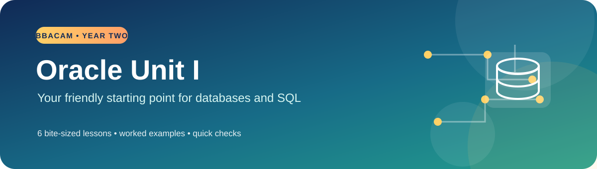

[](#unit-i-lesson-planner) [](#lesson-sequence) [](#check-for-learning)

# Oracle Unit I Lesson Planner

A ready-to-teach sequence for **BBACAM second-year students**. Each mini-lesson pairs one clear learning goal with a short explanation, a guided activity, and a quick check. Adjust the suggested 30-minute timings to fit your class.

## At a glance

| Session | Topic | Students will be able to… | Suggested time |
|:--:|:--|:--|:--:|
| 1 | DBMS and RDBMS | Explain how a relational database stores connected information | 30 min |
| 2 | Oracle tools and SQL | Tell SQL apart from SQL*Plus and identify Oracle tools | 30 min |
| 3 | Oracle data types | Choose a suitable type for common student records | 30 min |
| 4 | DDL | Create and change a simple table structure | 30 min |
| 5 | DML | Read, add, update, and delete table rows safely | 30 min |
| 6 | TCL and DCL | Save or undo changes and describe basic permissions | 30 min |

**Total suggested teaching time:** 3 hours across six mini-lessons.

## Before class

- Download the [Unit I tutorial](unit-1/Oracle_Unit_I_BBACAM_Tutorial.docx).
- Open the relevant slide deck from the lesson sequence below.
- For Sessions 4–6, prepare a board or demo environment to write SQL examples.
- Ask students to bring a notebook and predict what each SQL statement will do before revealing its result.

## Lesson sequence

<details>
<summary><strong>01 · Database foundations</strong> | DBMS and RDBMS | 30 minutes</summary>

**Learning goal:** Students explain what a DBMS does and how related tables connect.

**Teach · 8 min:** Describe a college database as a set of organized tables. Introduce STUDENT and COURSE, and show how a shared course_id links records.

**Do together · 12 min:** Give pairs sample fields (student_id, name, course_id, course_name). Ask them to sort the fields into STUDENT and COURSE tables and circle the shared field.

**Check · 5 min:** Ask students to explain why the course name should not need to be repeated for every student.

**Wrap up · 5 min:** Each student writes one sentence defining an RDBMS.

[Open Session 1 slide deck](unit-1/Oracle_Unit_I_01%20DBMS%20and%20RDBMS.pptx)

<details><summary>Quick check and suggested answer</summary>

**Question:** What makes an RDBMS relational?

**Answer:** It stores data in tables that can be connected through shared fields or keys.

</details>
</details>

<details>
<summary><strong>02 · Oracle tools and SQL</strong> | SQL and SQL*Plus | 30 minutes</summary>

**Learning goal:** Students distinguish the database, the SQL language, and a tool used to run SQL.

**Teach · 8 min:** Use the analogy: Oracle Database stores the information, SQL gives instructions, and SQL*Plus is one tool that sends instructions and shows results. Briefly mention Forms for data-entry screens and Reports for formatted output.

**Do together · 12 min:** Sort these labels into “language” or “tool”: SELECT, SQL*Plus, INSERT, Forms, DESCRIBE. Explain that DESCRIBE is a SQL*Plus helper command.

**Check · 5 min:** Students label each item in a one-line exit ticket.

**Wrap up · 5 min:** Ask students to complete: “SQL is ___; SQL*Plus is ___.”

[Open Session 2 slide deck](unit-1/Oracle_Unit_I_02%20Oracle%20tools%20and%20SQL.pptx)

<details><summary>Quick check and suggested answer</summary>

**Question:** Is SELECT a SQL command or a SQL*Plus command?

**Answer:** SELECT is SQL. SQL*Plus is the tool that can run it.

</details>
</details>

<details>
<summary><strong>03 · Choosing data types</strong> | Oracle data types | 30 minutes</summary>

**Learning goal:** Students select a data type that fits the value being stored.

**Teach · 8 min:** Introduce NUMBER, VARCHAR2, CHAR, DATE, CLOB, and BLOB with everyday examples.

**Do together · 12 min:** In pairs, match student_name, marks, grade_code, admission_date, long_notes, and photo to a type. Ask why a phone number is usually text.

**Check · 5 min:** Give three new values and ask students to choose a type independently.

**Wrap up · 5 min:** Students explain one choice in their own words.

[Open Session 3 slide deck](unit-1/Oracle_Unit_I_03%20Oracle%20data%20types.pptx)

<details><summary>Quick check and suggested answer</summary>

**Question:** Which type suits a name of varying length? Which suits a mark such as 87.50?

**Answer:** VARCHAR2 suits the name. NUMBER(p,s), such as NUMBER(5,2), suits the mark.

</details>
</details>

<details>
<summary><strong>04 · Defining tables</strong> | DDL | 30 minutes</summary>

**Learning goal:** Students recognize DDL and read a simple CREATE TABLE statement.

**Teach · 8 min:** Explain that DDL defines database structure. Introduce CREATE, ALTER, and DROP.

**Do together · 12 min:** Build a STUDENT table statement as a class:

```sql
CREATE TABLE student (
  student_id NUMBER,
  student_name VARCHAR2(60),
  admission_date DATE
);
```

Ask students to point out the table name and each column's data type.

**Check · 5 min:** Students identify whether a sample command creates, changes, or removes structure.

**Wrap up · 5 min:** Remind the class that Oracle DDL statements implicitly commit.

[Open Session 4 slide deck](unit-1/Oracle_Unit_I_04%20DDL%20builds%20the%20table.pptx)

<details><summary>Quick check and suggested answer</summary>

**Question:** Which command changes a table's structure?

**Answer:** ALTER.

</details>
</details>

<details>
<summary><strong>05 · Working with rows</strong> | DML | 30 minutes</summary>

**Learning goal:** Students identify common DML commands and use WHERE to target rows.

**Teach · 8 min:** Introduce SELECT, INSERT, UPDATE, and DELETE as ways to read or change rows.

**Do together · 12 min:** Ask students to predict which row this statement changes:

```sql
UPDATE student
SET student_name = 'Asha R.'
WHERE student_id = 1;
```

Then remove the WHERE line and discuss why the result is different.

**Check · 5 min:** Students add a suitable WHERE condition to a short update prompt.

**Wrap up · 5 min:** Each student writes a safety rule for UPDATE or DELETE.

[Open Session 5 slide deck](unit-1/Oracle_Unit_I_05%20DML%20adds%20and%20changes%20data.pptx)

<details><summary>Quick check and suggested answer</summary>

**Question:** What may happen if UPDATE has no WHERE clause?

**Answer:** Every row in the table may be updated.

</details>
</details>

<details>
<summary><strong>06 · Transactions and access</strong> | TCL and DCL | 30 minutes</summary>

**Learning goal:** Students explain how COMMIT, ROLLBACK, GRANT, and REVOKE are used.

**Teach · 8 min:** Describe TCL as control over data changes and DCL as control over permissions. Introduce COMMIT, ROLLBACK, SAVEPOINT, GRANT, and REVOKE.

**Do together · 12 min:** Give pairs command cards. Have them sort each command into “save or undo changes” or “manage access,” then explain one choice.

**Check · 5 min:** Students choose a command for two situations: save a change; give a user read access.

**Wrap up · 5 min:** Revisit the four command groups: DDL, DML, TCL, and DCL.

[Open Session 6 slide deck](unit-1/Oracle_Unit_I_06%20TCL%20and%20DCL%20protect%20your%20work.pptx)

<details><summary>Quick check and suggested answer</summary>

**Question:** Which command saves a transaction? Which gives a permission?

**Answer:** COMMIT saves the transaction. GRANT gives a permission.

</details>
</details>

## Check for learning

Use these as a final five-minute review, or as an exit ticket. Answers are tucked away so students can try first.

<details><summary>1. What is the difference between SQL and SQL*Plus?</summary>

SQL is a language; SQL*Plus is a tool that runs SQL and provides helper commands.

</details>

<details><summary>2. Which group includes CREATE TABLE?</summary>

DDL: Data Definition Language.

</details>

<details><summary>3. Why should UPDATE usually include WHERE?</summary>

WHERE limits which rows are changed. Without it, every row may be affected.

</details>

<details><summary>4. Which command saves uncommitted DML changes?</summary>

COMMIT.

</details>

## Download the teaching materials

- [Beginner tutorial with examples and narration scripts](unit-1/Oracle_Unit_I_BBACAM_Tutorial.docx)
- [All lesson slide decks](unit-1/)
- [Visual assets](assets/)

[⬆ Back to the lesson planner](#oracle-unit-i-lesson-planner)
